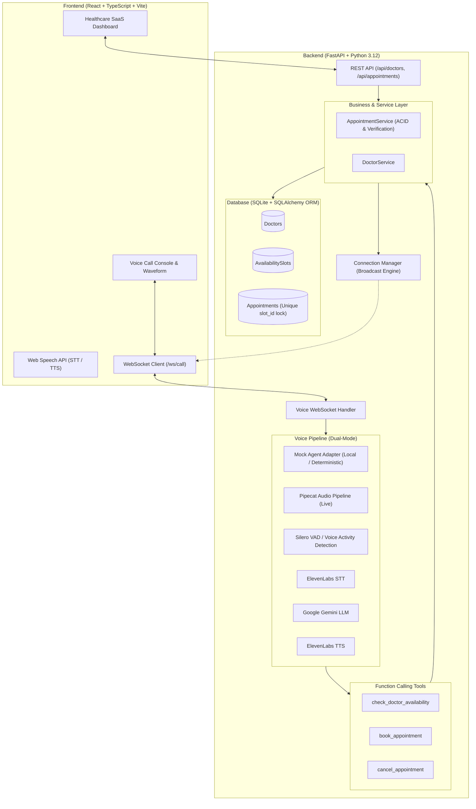

# MediCall — Voice AI Doctor Appointment Assistant

A production-grade, full-stack Voice AI Doctor Appointment Assistant application built for real-time healthcare scheduling. Allows patients to converse naturally via browser voice or text with an AI assistant that identifies callers by phone number, checks live physician availability, books appointments with ACID double-booking protection, and handles cancellations with verbal verification.

Supports **Mock Mode (Default, runs out-of-the-box with zero API keys required)** and **Live Mode (Pipecat + ElevenLabs STT/TTS + Google Gemini LLM)**.

---

## 1. Architecture Diagram



---

## 2. Technology Stack

- **Backend**: Python 3.12, FastAPI, Uvicorn, WebSockets, Pydantic v2, Pydantic-Settings
- **Database & ORM**: SQLite, SQLAlchemy 2.0 (ACID transactions, SQLite PRAGMA foreign keys, unique constraint double-booking locks)
- **Voice Pipeline**:
  - Live Mode: Pipecat AI, ElevenLabs Speech-to-Text, ElevenLabs Text-to-Speech, Google Gemini LLM
  - Mock Mode: Development Agent Adapter, Web Speech API integration, deterministic state machine
- **Frontend**: React 19, TypeScript, Vite, Tailwind CSS, Lucide React, Framer Motion
- **Testing**: Pytest, Pytest-Asyncio, HTTPX

---

## 3. Project Structure

```
MediCall/
├── backend/
│   ├── app/
│   │   ├── api/                # REST endpoints (doctors, availability, appointments, dashboard, voice)
│   │   ├── core/               # Configuration and environment settings
│   │   ├── database/           # SQLite session and seed data generator
│   │   ├── models/             # SQLAlchemy ORM models (Doctor, AvailabilitySlot, Appointment)
│   │   ├── repositories/       # Data access layers
│   │   ├── schemas/            # Pydantic schemas and phone number masking
│   │   ├── services/           # Business logic, ACID transactions, verification
│   │   ├── tools/              # Function calling schemas and tool handlers
│   │   ├── voice/              # Agent state, Mock adapter, and Pipecat live pipeline
│   │   ├── websocket/          # WebSocket connection manager and voice call handler
│   │   └── main.py             # FastAPI application entrypoint
│   ├── tests/                  # 16 automated test suites (API, Service, E2E Scenarios)
│   ├── .env.example            # Backend environment template
│   ├── pytest.ini              # Pytest configuration
│   └── requirements.txt        # Backend dependencies
├── frontend/
│   ├── src/
│   │   ├── components/         # Reusable UI components (Sidebar, Navbar, WaveformVisualizer, ConfirmationCard)
│   │   ├── hooks/              # Custom hooks (useVoiceCall)
│   │   ├── pages/              # Overview, VoiceAssistant, Doctors, Appointments, Activity, Settings
│   │   ├── services/           # API and WebSocket client services
│   │   ├── types/              # TypeScript definitions
│   │   ├── App.tsx             # Root dashboard controller
│   │   └── main.tsx            # Vite root entry
│   ├── .env.example            # Frontend environment template
│   └── vite.config.ts          # Vite build and proxy configuration
└── README.md
```

---

## 4. Quick Start (Mock Mode — Zero External API Keys)

The application starts in **Mock Mode** by default. You can test availability checking, phone verification, appointment booking, and cancellations without any paid API keys.

### 1. Start the Backend
```bash
cd backend

# Create & activate virtual environment
python -m venv venv
.\venv\Scripts\activate   # Windows PowerShell
# source venv/bin/activate # Linux / macOS

# Install dependencies
pip install -r requirements.txt

# Run server (automatically seeds database with 9 doctors & 100+ slots)
uvicorn app.main:app --host 0.0.0.0 --port 8000 --reload
```
Backend API will be running at `http://localhost:8000` (Docs: `http://localhost:8000/docs`).

### 2. Start the Frontend
In a separate terminal:
```bash
cd frontend

# Install npm dependencies
npm install

# Start Vite dev server
npm run dev
```
Open `http://localhost:5173` in your browser.

---

## 5. Live Mode Configuration

To activate real-time ElevenLabs STT/TTS and Google Gemini LLM via Pipecat:

1. Open `backend/.env`.
2. Update the credentials:
```env
VOICE_MODE=live
GEMINI_API_KEY=your_gemini_api_key_here
GEMINI_MODEL_ID=gemini-3.5-flash
ELEVENLABS_API_KEY=your_elevenlabs_api_key_here
ELEVENLABS_VOICE_ID=JBFqnCBsd6RMkjVDRZzb
ELEVENLABS_MODEL_ID=eleven_turbo_v2_5
```
3. Restart the backend. The dashboard status pill will immediately reflect **Live Mode Active**.
4. You can verify live integration status anytime at:
   - Lightweight status: `GET http://localhost:8000/api/health/integrations`
   - Active probe: `GET http://localhost:8000/api/health/integrations?probe=true`

---

## 6. How the Pipecat Voice Pipeline Works

1. **Browser Audio Input**: User speaks into the browser microphone.
2. **Audio Transport**: Audio frames are streamed over WebSocket / WebRTC to the backend.
3. **Voice Activity Detection (VAD)**: Silero VAD monitors speech boundaries and enables natural user interruption.
4. **Speech-to-Text (STT)**: ElevenLabs STT streams high-accuracy speech transcription.
5. **LLM & Function Calling**: Google Gemini receives conversational history and tool declarations. When a scheduling action is needed, Gemini yields tool calls (`check_doctor_availability`, `book_appointment`, or `cancel_appointment`).
6. **Tool Execution**: Function handlers execute operations directly against `AppointmentService` inside database transactions.
7. **Text-to-Speech (TTS)**: ElevenLabs TTS generates low-latency audio stream of the assistant's voice.
8. **Audio Output**: Streamed back to the browser speaker while telemetry updates the live waveform and transcript.

---

## 7. How Function Calling Tools Work

The system defines 3 strict tools:

### Tool 1: `check_doctor_availability`
- **Inputs**: `doctor_name` (optional), `speciality` (optional), `date` (optional).
- **Execution**: Queries `AvailabilitySlot` joined with `Doctor`. Returns only slots where `status == 'AVAILABLE'`. Never returns booked slots.

### Tool 2: `book_appointment`
- **Inputs**: `patient_name`, `phone_number`, `doctor_id`, `slot_id`, `confirmation_status`.
- **Validation**: Requires `confirmation_status == True`. Validates slot exists and is available.
- **ACID Transaction**: Atomically sets `slot.status = 'BOOKED'`, inserts `Appointment` with unique `slot_id` constraint, and commits. Returns reference (e.g. `APT-202611-XXXX`).

### Tool 3: `cancel_appointment`
- **Inputs**: `phone_number`, `appointment_reference` (optional), `confirmation_status`.
- **Validation**: Rejects cancellation if the appointment belongs to a different phone number.
- **ACID Transaction**: Sets `appointment.status = 'CANCELLED'`, re-opens `slot.status = 'AVAILABLE'`, preserving complete audit history.

---

## 8. Database Design & ACID Protections

### Entity Relationships
- **Doctor (1) ──< AvailabilitySlot (N)**: Cascade deletion, indexes on speciality and name.
- **Doctor (1) ──< Appointment (N)**: Audit trail.
- **AvailabilitySlot (1) ── (1) Appointment**: Protected by `UniqueConstraint('slot_id')` on Appointment table.

### Double-Booking Prevention
1. **Application-level atomic transaction**: Validates `slot.status == 'AVAILABLE'` inside session transaction.
2. **Database-level unique constraint**: `slot_id` column in `appointments` table has a `UNIQUE` constraint. Even under high-concurrency race conditions, SQLite enforces consistency and aborts concurrent writes with an `IntegrityError`.

---

## 9. Automated Testing

All 16 test suites pass:
```bash
cd backend
.\venv\Scripts\pytest.exe -v
```

### Coverage:
- `test_doctor_listing_and_filtering`: Roster lookup and speciality filtering.
- `test_availability_filtering`: Dynamic slot queries by doctor, speciality, and date.
- `test_booking_valid_slot`: Validates booking transaction and slot status transition.
- `test_rejecting_unavailable_slot`: Confirms booked slots cannot be re-booked.
- `test_preventing_double_booking_database_constraint`: Validates SQLite unique constraint integrity.
- `test_booking_confirmation_requirement`: Enforces verbal confirmation before booking.
- `test_cancellation_by_phone_number`: Verifies slot release and appointment history preservation.
- `test_rejecting_cancellation_for_different_phone_number`: Rejects unauthorized cancellation attempts.
- `test_multiple_appointment_handling`: Asks caller to select appointment when multiple exist.
- `test_scenario_a_successful_booking_flow`: Full 11-step end-to-end conversation booking.
- `test_scenario_b_successful_cancellation_flow`: Full 10-step end-to-end conversation cancellation.
- `test_api_endpoints`: Health, doctors, availability, stats, and voice config endpoints.

---

## 10. Manual Testing Walkthrough

### Scenario A: Booking an Appointment
1. Navigate to **Voice Assistant** and click **Start Phone Call**.
2. Agent greets you and asks for your phone number.
3. Speak or type: `"My phone number is 555-123-4567"`.
4. Agent reads back: `"I heard your phone number as 5551234567. Before we proceed, could you please confirm if this number is correct?"`
5. Speak or type: `"Yes, that is correct."`
6. Speak or type: `"I want to see Dr. Sarah Jenkins"` (or `"I need a cardiologist"`).
7. Agent checks database and lists available slots (e.g. 09:00 AM, 10:00 AM).
8. Speak or type: `"Book the 09:00 AM slot."`
9. Agent repeats details: `"You are booking an appointment with Dr. Sarah Jenkins (Cardiology) on 2026-11-25 at 09:00 AM. Total consultation fee is $150. Do you confirm this booking?"`
10. Speak or type: `"Yes, confirm the booking."`
11. Booking Confirmation Card displays inside the call screen with reference code `APT-XXXXXXXX`.
12. Navigate to **Appointments** or **Overview** to see the new booking highlighted in the table!

### Scenario B: Cancelling an Appointment
1. Start call on the Voice Assistant page.
2. Provide and confirm your phone number: `"555-123-4567"`.
3. Say: `"I want to cancel my appointment."`
4. Agent locates your active booking: `"I found your appointment APT-XXXXXXXX with Dr. Sarah Jenkins. Are you sure you want to cancel this appointment?"`
5. Say: `"Yes, please cancel it."`
6. Cancellation Card appears, appointment status updates to `CANCELLED`, and the slot is released back to the schedule.

---

## 11. Technical Interview Explanation (Cheat Sheet)

If asked to explain this project during an SDE interview:

> *"The system is an AI voice scheduling assistant designed around strict data integrity and privacy rules. The caller is identified solely by their spoken phone number, which must be read back and verbally confirmed before any scheduling operations can occur.*
>
> *The architecture separates speech and conversational intelligence from core database transactions. The AI interacts with the database exclusively through function-calling tools (`check_doctor_availability`, `book_appointment`, and `cancel_appointment`). Double booking is prevented at both the application level through ACID transactions and at the database level using a unique constraint on the slot foreign key.*
>
> *The system features a dual-mode engine: in Mock Mode, it runs completely offline with a deterministic agent adapter and browser Web Speech API, allowing full end-to-end testing without external API keys. In Live Mode, it connects to a Pipecat pipeline orchestrating ElevenLabs STT, Gemini LLM with function calling, and ElevenLabs TTS over low-latency WebSockets."*
