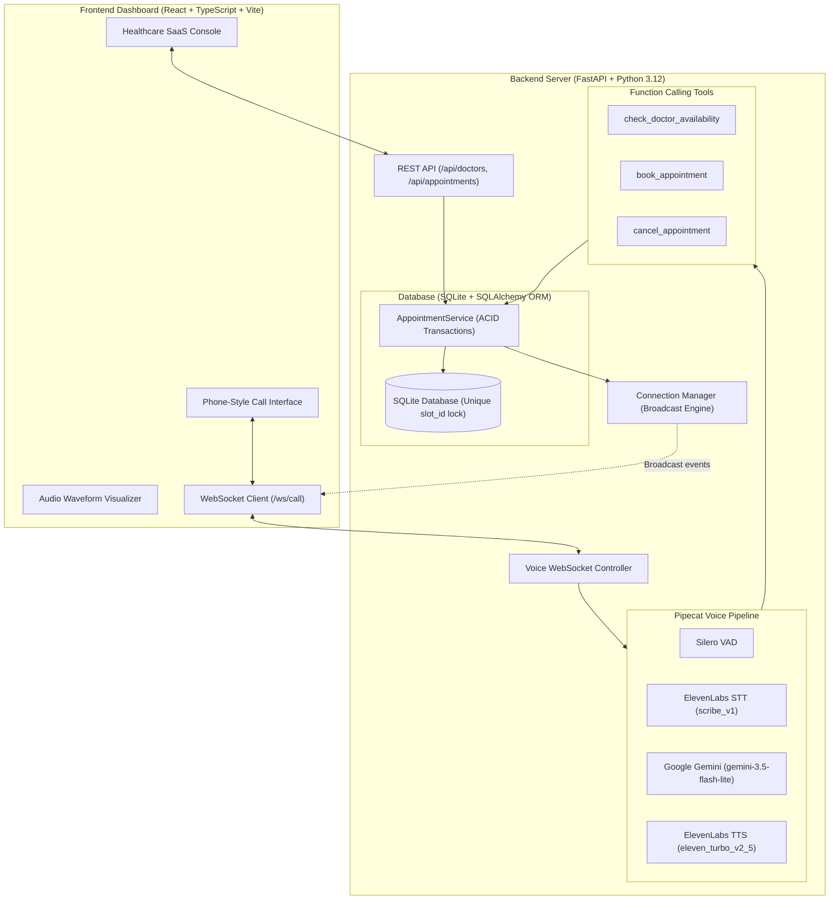

# Voice AI Doctor Appointment Assistant
### SDE Intern – Round 1 Assignment Submission

A real-time, production-grade Voice AI doctor appointment scheduling system. Callers converse naturally with an AI agent in the browser to check physician availability, book appointments, and cancel existing ones. The system identifies callers solely by the phone number they speak out loud, verbally confirms all scheduling decisions, prevents double bookings with database ACID transactions, and visualizes call activity and appointment records through a healthcare SaaS dashboard.

---

## 1. Project Overview & Required Tech

| Component | Technology | Description |
| :--- | :--- | :--- |
| **Voice Framework** | **Pipecat AI (Python 3.12)** | Real-time audio pipeline and tool function-calling orchestration |
| **LLM Engine** | **Google Gemini (`gemini-3.5-flash-lite`)** | High-speed conversational reasoning and multi-turn function calling |
| **Speech-to-Text (STT)** | **ElevenLabs (`scribe_v1`)** | Low-latency speech recognition and streaming transcription |
| **Text-to-Speech (TTS)** | **ElevenLabs (`eleven_turbo_v2_5`)** | Natural neural speech synthesis (Voice ID: `JBFqnCBsd6RMkjVDRZzb`) |
| **Voice Activity Detection** | **Silero VAD** | Real-time speech boundary detection for turn-taking |
| **Backend API** | **FastAPI + WebSockets** | Asynchronous HTTP endpoints and bi-directional voice streaming |
| **Database & ORM** | **SQLite + SQLAlchemy 2.0** | Persistent schema with ACID transactions & unique slot locks |
| **Frontend Dashboard** | **React 19 + TypeScript + Vite** | Production-quality healthcare SaaS console with Tailwind CSS |

> **LLM Selection Note**: Google Gemini (`gemini-3.5-flash-lite`) was chosen for this project because it provides sub-second latency, precise function/tool calling compatibility, and generous free tier quotas, ensuring cost-free evaluation and high reliability.

---

## 2. Voice Pipeline Description (In Plain Words)

The voice pipeline runs a full duplex conversation loop:

$$\text{Caller Audio} \longrightarrow \text{ElevenLabs STT} \longrightarrow \text{Gemini LLM (Function Calling)} \longrightarrow \text{ElevenLabs TTS} \longrightarrow \text{Caller Audio}$$

Here is how each turn executes step by step:

1. **Audio Capture & VAD**: The caller speaks into the browser. Voice activity detection detects speech pauses and streams the audio over a dedicated WebSocket connection (`/ws/call`).
2. **Speech-to-Text (STT)**: ElevenLabs STT transcribes the caller's spoken words in real time.
3. **Conversational LLM Reasoning**: The transcription is fed to **Google Gemini**. Gemini evaluates the caller's intent against registered function-calling tools:
   - `check_doctor_availability`: Queries verified slots for a doctor, specialty, or date.
   - `book_appointment`: Reserves a slot using the caller's verified phone number.
   - `cancel_appointment`: Cancels a caller's booking after confirming phone number ownership.
4. **Tool Execution & Database Commitment**: When Gemini invokes a tool, the backend executes the operation directly inside an isolated database transaction, enforcing ACID guarantees and verifying that the slot is not already taken.
5. **Text-to-Speech (TTS)**: The LLM's verbal response is synthesized by ElevenLabs TTS and streamed back to the browser speaker.
6. **Acoustic Echo Isolation**: While the assistant speaks, the microphone is automatically muted with an acoustic delay guard to prevent the AI from hearing itself through laptop speakers.
7. **Real-Time Dashboard Sync**: Every scheduling action (booking, cancellation, tool execution) is broadcast via WebSockets to instantly update the appointment table, activity logs, and metric cards without requiring a page refresh.

---

## 3. Architecture Diagram



---

## 4. Key Features Implemented

### Part A: Voice Pipeline & Business Logic
- **Caller Identification by Spoken Phone Number**: Callers are identified strictly by the phone number they speak out loud. No passwords, logins, or OTPs.
- **Verbal Number Confirmation**: The agent reads the recognized phone number back to the caller (e.g., *"I have your phone number as 907-651-8281. Can you please confirm if this number is correct?"*) before proceeding.
- **Double-Booking Prevention**:
  - Application layer: Validates `slot.status == 'AVAILABLE'` inside an atomic transaction.
  - Database layer: `slot_id` has a strict `UNIQUE` constraint on the `appointments` table. Any concurrent double-booking attempt triggers an immediate database integrity rollback.
- **Ownership Verification on Cancellation**: A caller can only cancel an appointment if their verified phone number matches the number used during booking.
- **Automatic Call Termination**: 4.5 seconds after a booking is verbally confirmed and the reference code is read out, the agent politely concludes and disconnects the call.

### Part B: Production Healthcare Dashboard
- **Live AI Integration Status Panel**: Visibly monitors the live operational state of Pipecat, Gemini, and ElevenLabs with an active health probe button (`/api/health/integrations`).
- **Phone-Style Voice Assistant Screen**:
  - Start / End voice call controls.
  - Live animated dual-tone audio waveform.
  - Real-time conversation transcript with speaker badges.
  - In-call booking confirmation card displaying reference code, doctor, date, and fee.
  - Hardware microphone indicator (<span style="color:#e11d48">Mic Muted</span> during speech, <span style="color:#059669">Mic Active</span> when listening).
- **Physician Directory**: Browse doctors by department (Cardiology, Neurology, Dermatology, Orthopedics, Pediatrics, General Medicine), view consultation fees, and inspect live available slots in an interactive modal.
- **Appointments Management Ledger**: Real-time table with status filters (Booked, Cancelled), phone number privacy masking (`***-***-8281`), and secure phone-verified cancellation dialog.
- **Patient Directory**: Summarizes unique caller phone identities, consultation counts, assigned doctors, and last visit dates.
- **Activity & Telemetry Logs**: Audit trail showing tool execution latencies (ms), sanitized arguments, and SQLite ACID confirmation badges.

---

## 5. How to Run the Project

### Prerequisites
- Python 3.11+
- Node.js 18+ & npm

---

### Step 1: Backend Setup

```bash
cd backend

# 1. Create and activate a Python virtual environment
python -m venv venv

# Windows PowerShell:
.\venv\Scripts\activate
# macOS / Linux:
# source venv/bin/activate

# 2. Install Python dependencies
pip install -r requirements.txt

# 3. Configure environment variables (No keys committed)
# Copy the template to .env
cp .env.example .env
```

#### Dual Mode Configuration in `backend/.env`:

- **Mock Mode (Default — Zero API keys required)**:
  Runs out-of-the-box offline using the deterministic agent adapter and browser speech synthesis.
  ```env
  VOICE_MODE=mock
  ```

- **Live Mode (Full Pipecat + Gemini + ElevenLabs pipeline)**:
  ```env
  VOICE_MODE=live
  GEMINI_API_KEY=your_gemini_api_key_here
  GEMINI_MODEL_ID=gemini-3.5-flash-lite
  ELEVENLABS_API_KEY=your_elevenlabs_api_key_here
  ELEVENLABS_VOICE_ID=JBFqnCBsd6RMkjVDRZzb
  ELEVENLABS_MODEL_ID=eleven_turbo_v2_5
  ```

```bash
# 4. Start the backend server
uvicorn app.main:app --host 0.0.0.0 --port 8000 --reload
```
The backend will be running at `http://localhost:8000` (Swagger docs: `http://localhost:8000/docs`). On startup, it automatically creates the SQLite database and seeds **9 verified doctors** and **252 upcoming slots**.

---

### Step 2: Frontend Setup

In a new terminal:

```bash
cd frontend

# 1. Install npm packages
npm install

# 2. Start Vite development server
npm run dev
```

Open your browser to `http://localhost:5173`.

---

## 6. Required Function Calling Tools

| Tool Name | Parameters | Purpose |
| :--- | :--- | :--- |
| `check_doctor_availability` | `doctor_name` (str, optional)<br>`speciality` (str, optional)<br>`date` (str, optional) | Queries the database for open appointment slots. Requires either a doctor or specialty to prevent dumping irrelevant clinic schedules. |
| `book_appointment` | `phone_number` (str)<br>`doctor_id` (int)<br>`slot_id` (int)<br>`patient_name` (str)<br>`confirmation_status` (bool) | Locks the slot, creates the appointment record, commits the transaction, and returns the reference code (`APT-XXXX`). Requires `confirmation_status=True`. |
| `cancel_appointment` | `phone_number` (str)<br>`appointment_reference` (str)<br>`confirmation_status` (bool) | Verifies that the caller's phone matches the booking, sets status to `CANCELLED`, releases the slot back to `AVAILABLE`, and commits. |

---

## 7. Automated Test Suite

The backend includes 18 automated test suites verifying all API endpoints, database ACID constraints, double-booking prevention, and end-to-end multi-turn conversations.

```bash
cd backend
.\venv\Scripts\pytest tests -v
```

### Test Coverage Highlights:
- `test_preventing_double_booking_database_constraint`: Confirms SQLite unique constraint prevents race-condition double bookings.
- `test_booking_confirmation_requirement`: Verifies booking is rejected without explicit verbal confirmation.
- `test_cancellation_by_phone_number`: Verifies slot release and ownership match.
- `test_rejecting_cancellation_for_different_phone_number`: Verifies HIPAA-style phone isolation.
- `test_scenario_a_successful_booking_flow`: Full multi-turn booking conversation.
- `test_scenario_b_successful_cancellation_flow`: Full multi-turn cancellation conversation.
- `test_integrations_health_endpoint_with_probe`: Live network connectivity probes for Gemini and ElevenLabs.
